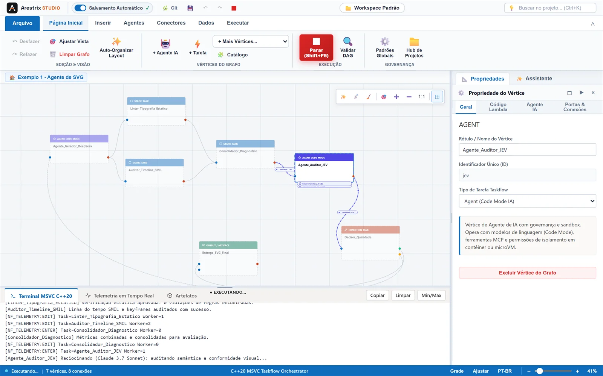

<p align="center">
  <picture>
    <source media="(prefers-color-scheme: dark)" srcset="docs/assets/arestrix-logo-reverse.svg">
    
  </picture>
</p>

<p align="center">
  <b>English</b> &nbsp;|&nbsp; <a href="README.pt-BR.md">Português</a>
</p>

<p align="center">
  <a href="https://github.com/frankalcantara/Arestrix/releases"></a>
  <a href="LICENSE"></a>
  
  
</p>

<p align="center">
  <b>Visual orchestration and native C++20 compilation for AI agent pipelines.</b><br>
  <i>Design the graph, compile it to Taskflow, and ship a standalone runner.</i>
</p>

<p align="center">
  <b>Beta 1.5</b> &nbsp;·&nbsp; <a href="CHANGELOG.md">Changelog</a> &nbsp;·&nbsp; <a href="docs/README.md">Documentation</a>
</p>

<p align="center">
  
</p>

---

## What is Arestrix?

Arestrix is a desktop studio and native compiler for AI agent workflows. You draw a pipeline on a
graph canvas; Arestrix validates it, generates C++20 source and compiles it with
[Taskflow](https://github.com/taskflow/taskflow) into parallel task DAGs.

- **Visual design, native execution.** The graph is not interpreted. It becomes a compiled program.
- **Local-first by default.** Projects, memory, logs and databases stay on the machine; only model
  and MCP calls leave it.
- **Built for delivery.** Export a standalone runner with optional MSI/MSIX packaging for managed
  Windows deployment.
- **Secrets stay out of the project.** Credentials are resolved at runtime through Windows DPAPI or
  Azure Key Vault / Managed Identity.
- **Reviewable artifacts.** Graphs, generated C++ and packaging metadata are text files that can be
  versioned and reviewed.

## Why Arestrix?

| Concern | How Arestrix addresses it |
| :--- | :--- |
| **Prototype-to-production gap** | The same graph can be executed in the Studio or compiled into a distributable runner. |
| **Runtime footprint** | The Studio avoids Electron and the generated program runs as a native binary. |
| **Credential exposure** | Project files hold variable names or `${NAME}` references, never secret values. |
| **Operational trust** | Exported packages carry an integrity manifest; the runner can verify it before execution. |
| **Vendor lock-in** | MIT-licensed, local project format and support for multiple model providers and MCP servers. |

## Feature highlights

- **Visual graph editor** — Office-inspired ribbon, templates, decision vertices, feedback loops,
  undo/redo and graph validation.
- **Native C++20 compiler** — inspect generated Taskflow code in Monaco, compile it with MSVC or
  GCC/Clang, and reuse unchanged builds.
- **Agent runtime** - tool loop, sandboxes, per-vertex model settings, live telemetry and batch
  resume.
- **Local AI models** - managed llama.cpp runtime, pre-approved GGUF catalog, hardware-aware
  recommendation and CPU fallback. No inference runtime is bundled by default.
- **Enterprise AI Gateway** - on-prem proxy with virtual keys, budgets and rate limits by
  key/project/user/provider/model, usage ledger and fail-closed routing. Local models are exempt.
- **Project memory (AMG)** - SQLite temporal multigraph with lessons, a shared Blackboard,
  `memory_search`/`memory_record_lesson`, success/failure episodes, injected/used-memory tracking,
  a token-budgeted brief, API-usage metrics and memory A/B in the Studio.
- **Workspaces, skills and MCP** - local skill catalogs and MCP servers with a persistent session
  per server, including HTTP/Streamable HTTP and per-server headers.
- **Delivery and governance** — standalone runner, MSI/MSIX packaging, DPAPI/Azure Key Vault
  integration and HMAC integrity verification.
- **Bilingual** — interface and documentation in English and Portuguese.

See the [feature showcase](docs/product/showcase.md) for screenshots of each area.

## Quick start

### Requirements

- Git 2.30+
- Node.js 20+
- Python 3.10+
- CMake 3.20+
- A C++20 compiler: MSVC v143+ on Windows, GCC 11+ or Clang 14+ on Linux

### Build and launch

```bash
# Clone with the pinned third-party submodules
git clone --recurse-submodules https://github.com/frankalcantara/Arestrix.git
cd Arestrix

# Install frontend dependencies
npm ci

# Build the frontend and the C++ backend, then open the Studio
python CppCore/dev.py
```

Optional: enable the secret-scanning pre-commit hook once per clone with `npm run hooks:install`.

Inside the Studio:

1. Open one of the [examples](examples/README.md) or create a project.
2. Choose a provider and model in **Global Defaults**; API keys are read from environment variables
   or your credential vault.
3. Press **F5** to compile and run the graph with live telemetry.
4. Use **Export Standalone Runner** to package the pipeline for delivery.

For CI, servers or a terminal-only workflow, use the headless runner generated by the same build:

```powershell
.\arestrix-cli.exe run .\examples\04-memoria\pipelines\main.json --root .\examples\04-memoria
```

See [`arestrix-cli`](docs/en/arestrix-cli.md) for `gen`, `env`, `check`, `doctor`, native
`memory report`, `mcp`, `project`, `--ci`, batch mode, exit codes and troubleshooting.

No API key is required to run the scripted end-to-end examples:

```bash
python scripts/e2e_examples.py
```

## Documentation

| Start here | What you will find |
| :--- | :--- |
| [Documentation hub](docs/README.md) | The complete guide, organized by language and topic. |
| [Getting started](docs/en/getting-started.md) | Requirements, build, model configuration and first execution. |
| [Architecture](docs/en/architecture.md) | Studio, engine, WebUI and the graph-to-C++ pipeline. |
| [`arestrix-cli`](docs/en/arestrix-cli.md) | Headless execution, CI usage, exit codes and troubleshooting. |
| [Examples](examples/README.md) | Eleven runnable projects, from a two-agent pipeline to callable subflows, flow Call vertices, parallel calls, generated forms, memory and web-research workflows. |
| [Test audit log](docs/quality/test-audit-log.md) | Chronological test rounds and integrity audits. |
| [Changelog](CHANGELOG.md) | Release history, changes and known limitations. |

## Project status

**Beta 1.5** is an early public release. The Studio runs on Windows and Linux; programs generated
from a graph currently target Windows. Beta APIs, file formats and command-line flags may change
before general availability. See the [changelog](CHANGELOG.md) for the current limitations.

## Security

- Report vulnerabilities privately according to [SECURITY.md](SECURITY.md).
- Read the [security and governance model](docs/security/governance.md).
- Check [dependency advisories](docs/security/dependency-advisories.md) before upgrading npm
  packages.
- Third-party components and licenses are listed in [THIRD_PARTY_NOTICES.md](THIRD_PARTY_NOTICES.md).

## Contributing

Contributions are welcome. Read [CONTRIBUTING.md](CONTRIBUTING.md) for setup, tests, commit
conventions and the pull request checklist, and follow the [Code of Conduct](CODE_OF_CONDUCT.md).

- Use [GitHub Discussions](https://github.com/frankalcantara/Arestrix/discussions) for questions and
  ideas.
- Use the issue templates for reproducible bugs and feature requests.
- Do not open a public issue for a security vulnerability.

## Acknowledgements

Arestrix builds on Taskflow, simdjson, WebUI, SQLite, Monaco Editor, i18next and Inter, among other
open-source projects. See [THIRD_PARTY_NOTICES.md](THIRD_PARTY_NOTICES.md) and
[`third_party/`](third_party/README.md) for versions, roles and licenses.

## Contact

- General, commercial and conduct matters: [contact@arestrix.com](mailto:contact@arestrix.com)
- Security reports: follow [SECURITY.md](SECURITY.md) and use GitHub private reporting first.
- Technical questions: [GitHub Discussions](https://github.com/frankalcantara/Arestrix/discussions)

## License

Released under the [MIT License](LICENSE). Free for commercial and academic use.
