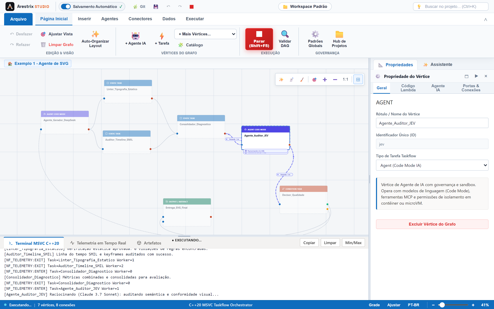
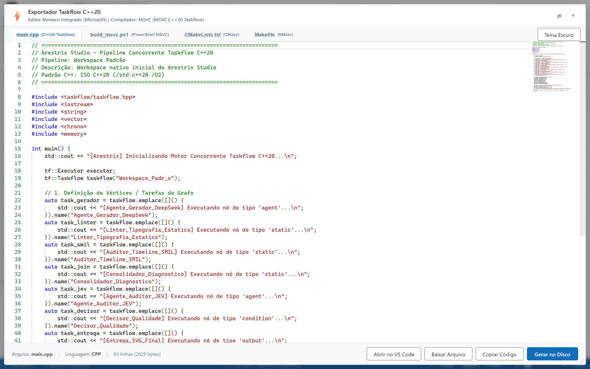
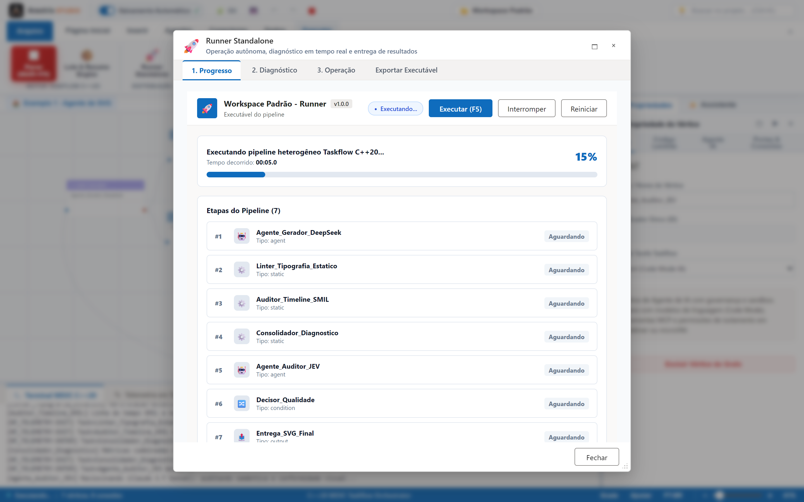
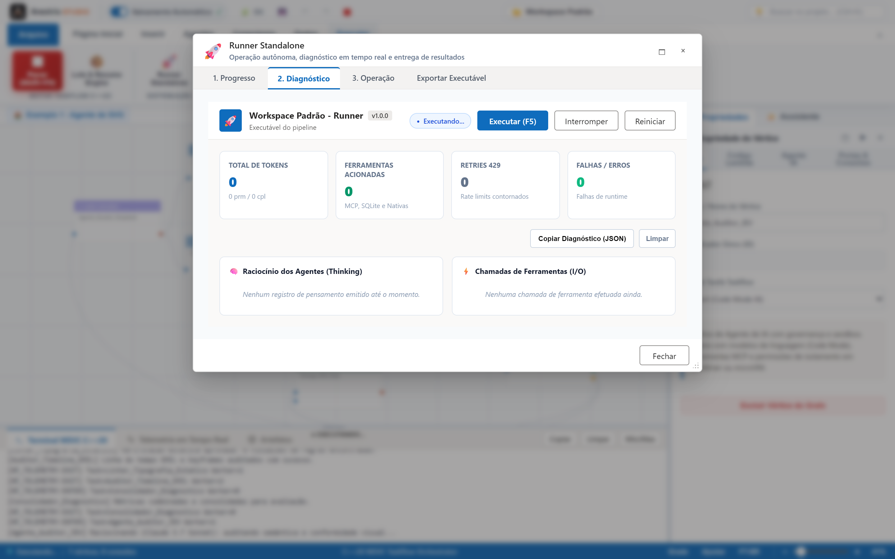
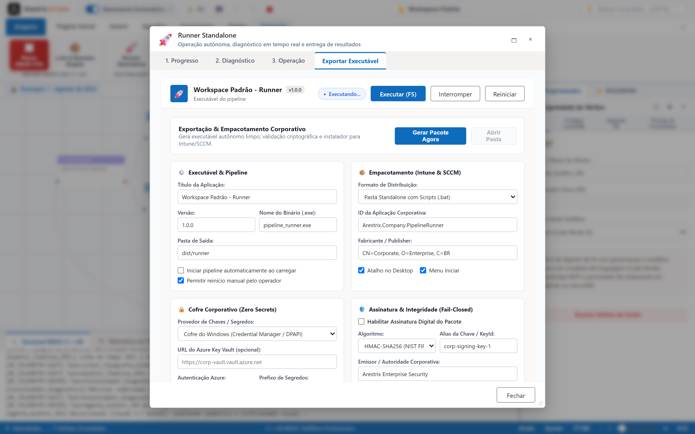

<p align="center">
  <picture>
    <source media="(prefers-color-scheme: dark)" srcset="docs/assets/arestrix-logo-reverse.svg">
    
  </picture>
</p>

<p align="center">
  <a href="README.md">English</a> &nbsp;|&nbsp; <b>Português</b>
</p>

<p align="center">
  
  
  
  
  
  
  
</p>

<p align="center">
  <b>Plataforma Empresarial Visual de Orquestração e Compilação Nativa de Agentes Inteligentes</b><br>
  <i>Do grafo visual ao executável C++20 de alta performance com segurança de ponta a ponta e zero dependências de runtime.</i>
</p>

<p align="center">
  
</p>

---

## Sumário

- [Visão Geral e Posicionamento Empresarial](#visão-geral-e-posicionamento-empresarial)
- [Comparativo Competitivo: Arestrix vs. Alternativas](#comparativo-competitivo-arestrix-vs-alternativas)
- [Pilares de Segurança e Governança Corporativa](#pilares-de-segurança-e-governança-corporativa)
- [Galeria de Recursos em Alta Resolução](#galeria-de-recursos-em-alta-resolução)
- [Arquitetura: Do Canvas ao Taskflow C++20](#arquitetura-do-canvas-ao-taskflow-c20)
- [Início Rápido](#início-rápido)
- [Construído em Colaboração com Agentes Inteligentes](#construído-em-colaboração-com-agentes-inteligentes)
- [Documentação Completa](#documentação-completa)
- [Agradecimentos](#agradecimentos)
- [Licença](#licença)

---

## Visão Geral e Posicionamento Empresarial

Empresas de todos os portes enfrentam um desafio crítico ao adotar agentes autônomos de IA: **a lacuna entre protótipos de script e sistemas corporativos em produção**.

A maioria das soluções atuais impõe dependências complexas (interpretação lenta de Python, containers pesados de Node.js, ambientes virtuais frágeis), vazamento de credenciais em arquivos `.env`, ou aprisionamento em nuvens SaaS com cobranças recorrentes imprevisíveis e riscos de soberania de dados.

O **Arestrix** foi projetado para redefinir esse paradigma:
1. **Design Acessível, Execução Nativa**: Qualquer profissional — de analistas e engenheiros a advogados, auditores e médicos — pode desenhar pipelines complexos de agentes em um canvas visual intuitivo inspirado no Microsoft Office 365.
2. **Compilação C++20 com Taskflow**: O grafo não é interpretado; ele é traduzido em código C++20 moderno de alta performance, utilizando o motor de paralelismo heterogêneo [Taskflow](https://github.com/taskflow/taskflow).
3. **Distribuição Standalone sem Fricção**: Exportação com um clique para executáveis autônomos (`.exe`), instaladores corporativos WiX MSI e pacotes MSIX homologáveis para **Microsoft Intune e SCCM**, sem necessidade de instalar Node, Python ou Docker na máquina do usuário final.
4. **Segurança Fail-Closed e Governança Estrita**: Integração nativa com Windows Credential Manager (DPAPI) e Azure Key Vault (com suporte a Managed Identity / IMDS), validação criptográfica HMAC SHA-256 e sandboxing estrito.

---

## Comparativo Competitivo: Arestrix vs. Alternativas

A tabela abaixo destaca as diferenças arquiteturais e operacionais entre o **Arestrix**, plataformas de automação baseadas em servidor como o **n8n**, e wrappers de script para agentes como **Hermes Agent** e **Pi Agent**:

| Dimensão Estratégica | Arestrix | n8n | Hermes Agent (Nous) | Pi Agent (Inflection) |
| :--- | :--- | :--- | :--- | :--- |
| **Paradigma de Execução** | **Binário Nativo C++20** (Taskflow) compilado em código de máquina. | Interpretado em **Node.js** com loops de eventos assíncronos. | Script **Python** com dependências de pacotes e GIL. | Serviço **Cloud Proprietário** em servidores remotos. |
| **Distribuição para Usuário Final** | **Executável autônomo (`.exe`), MSI e MSIX** de 1 clique, zero dependências. | Requer servidor dedicado, Docker ou instância Cloud SaaS. | Requer terminal, `venv`, Python 3.10+ e bibliotecas no cliente. | Apenas interface Web/App do provedor; não exportável. |
| **Overhead de Memória e CPU** | **Mínimo (< 30 MB)**; paralelismo nativo em hardware multi-core. | **Alto (> 400 MB)** por worker Node.js e consumo de heap. | **Médio/Alto** devido ao runtime Python e bibliotecas de ML. | Desconhecido (execução remota no datacenter do provedor). |
| **Gestão de Segredos & Chaves** | **Windows DPAPI e Azure Key Vault**; zero segredos no disco e limpeza de memória. | Segredos gravados no banco de dados do servidor ou `.env`. | Arquivos `.env` locais ou variáveis de ambiente em texto plano. | Gerenciado pela nuvem do provedor; dados trafegam fora da empresa. |
| **Integridade Criptográfica** | **Assinatura HMAC SHA-256** com verificação fail-closed no boot. | Não aplicável a workflows distribuídos. | Não possui validação de integridade de pacote. | Não aplicável (código fechado). |
| **Orquestração Visual de Grafos** | **Sim**: Canvas interativo, Ribbon Office 365, ciclos e feedback com teto de custo. | **Sim**: Canvas visual voltado para ETL/Webhooks. | **Não**: Interface exclusivamente via linha de comando (CLI). | **Não**: Interface conversacional padrão de chat. |
| **Homologação Corporativa TI** | **MSI/MSIX silencioso** (`msiexec /qn`) para **Intune e SCCM**. | Requer governança de containers ou infraestrutura web corporativa. | Inviável para implantação em massa em máquinas corporativas travadas. | Incompatível com políticas de software local/offline corporativo. |
| **Suporte ao Model Context Protocol (MCP)** | **Nativo**: Servidores MCP integrados e catálogo de ferramentas extensível. | Suporte parcial via integrações customizadas de terceiros. | Focado em chamadas de função específicas de LLM. | Fechado para ferramentas externas customizadas. |
| **Custo de Licenciamento** | **Código Aberto (MIT)**; pague exclusivamente a API de LLM utilizada. | Modelo Fair-Code / Comercial com limites em automações avançadas. | Código Aberto (Apache 2.0). | Assinatura comercial ou serviço proprietário fechado. |

---

## Pilares de Segurança e Governança Corporativa

O Arestrix adota a filosofia de segurança em profundidade (*defense-in-depth*), projetada para aprovação imediata por equipes de Segurança da Informação e Compliance:

```
┌─────────────────────────────────────────────────────────────────────────┐
│                    Arestrix Enterprise Security Model                   │
├──────────────────────────┬──────────────────────────┬───────────────────┤
│    1. Zero-Secret Core   │ 2. Cryptographic Trust   │ 3. IT Deployment  │
│  • DPAPI / Azure Vault   │  • SHA-256 HMAC Sign     │  • MSI & MSIX     │
│  • IMDS Managed Identity │  • Tamper-evident check  │  • Silent Intune  │
│  • Secure memory purge   │  • Fail-closed policies  │  • Audit logging  │
└──────────────────────────┴──────────────────────────┴───────────────────┘
```

1. **Arquitetura Zero-Secret**: Nenhuma senha, token ou chave de API é gravada no executável gerado ou nos arquivos de projeto. A resolução de credenciais ocorre em tempo de execução consultando o **Cofre de Credenciais do Windows (DPAPI)** ou o **Azure Key Vault** (autenticado de forma transparente via **Managed Identity/IMDS** em ambientes corporativos). Ao término da execução, as variáveis sensíveis são zeradas da memória (`SecureZeroMemory`).
2. **Assinatura Criptográfica de Pacotes**: Todo pipeline empacotado para o Runner Standalone gera um manifesto de integridade (`arestrix.manifest.sig`). Na inicialização, a assinatura SHA-256 HMAC é checada; caso qualquer arquivo de configuração, prompt ou dependência tenha sido adulterado, o executável recusa a inicialização (*fail-closed*).
3. **Homologação para Intune e SCCM**: Com suporte aos geradores de instalador WiX MSI e MSIX corporativo, a equipe de TI corporativa pode distribuir atualizações silenciosas (`msiexec /i arestrix-runner.msi /qn`) com políticas corporativas centralizadas.
4. **Sandboxing e Confinamento de Escopo**: Operações de escrita em disco executadas por agentes e ferramentas são restritas à raiz do projeto. Laços de feedback e auto-reparação possuem limites rígidos configuráveis de chamadas e teto orçamentário para impedir loops infinitos de custos de API.

---

## Galeria de Recursos em Alta Resolução

### 1. Studio Principal & Canvas de Fluxo de Agentes
Interface limpa e profissional inspirada no Microsoft Office 365 exibindo um pipeline multi-agente em **execução concorrente ativa (F5)**: visualização de nós concluídos e ativos, telemetria em tempo real com streaming de raciocínio, terminal de compilação MSVC C++20 acoplado e inspetor de propriedades do agente.

<p align="center">
  
</p>

### 2. Compilação e Geração Nativa C++20 Taskflow
Inspecione em tempo real o código C++20 modular e limpo gerado pelo Arestrix através do Monaco Editor embutido. Ramos paralelos do grafo transformam-se em tarefas concorrentes sem race conditions.

<p align="center">
  
</p>

### 3. Runner Standalone: Execução e Linha do Tempo
Telas dedicadas para o usuário final que executam o pipeline de agentes com visualização em linha do tempo, status de cada nó e histórico completo de iterações.

<p align="center">
  
</p>

### 4. Telemetria e Diagnóstico em Tempo Real
Acompanhe métricas vitais de execução: latência de nós, tokens consumidos por segundo, streaming de pensamento (*thinking/reasoning trace*) do modelo e inspeção de argumentos das chamadas de ferramentas.

<p align="center">
  
</p>

### 5. Governança Corporativa e Empacotamento para Distribuição
Configure cofres de credenciais (DPAPI / Azure Vault), gere assinaturas digitais HMAC, empacote instaladores MSI/MSIX para SCCM/Intune e exporte executáveis autônomos prontos para produção.

<p align="center">
  
</p>

---

## Arquitetura: Do Canvas ao Taskflow C++20

O Arestrix adota uma arquitetura em camadas projetada para eliminar o overhead do Electron e garantir desempenho de nível industrial:

```
┌────────────────────────────────────────────────────────┐
│  Arestrix Studio UI (TypeScript + Three.js + Monaco)    │
└───────────────────────────┬────────────────────────────┘
                            │ WebUI IPC / RPC bidirecional
┌───────────────────────────▼────────────────────────────┐
│  CppCore Backend (C++20, CivetWeb, simdjson, SQLite)   │
├────────────────────────────────────────────────────────┤
│  Taskflow Engine (DAG heterogênea de tarefas C++20)    │
├────────────────────────────────────────────────────────┤
│  Agent Tool Loop (OpenAI, Anthropic, DeepSeek, MCP)    │
├────────────────────────────────────────────────────────┤
│  Enterprise Vaults (Windows DPAPI & Azure Key Vault)   │
└────────────────────────────────────────────────────────┘
```

- **Frontend sem Electron**: Utiliza a biblioteca ultraleve [WebUI](https://github.com/webui-dev/webui) com o servidor [CivetWeb](https://github.com/civetweb/civetweb) embarcado, consumindo uma fração minúscula de memória comparada a runtimes tradicionais.
- **Parsing em Velocidade de Memória**: Toda comunicação serializada e manifestos de dados utilizam [simdjson](https://github.com/simdjson/simdjson), processando gigabytes de dados estruturados por segundo.
- **Armazenamento de Estado Transparente**: Histórico de sessões, memória de longo prazo e telemetria armazenados localmente com [SQLite](https://sqlite.org).

---

## Início Rápido

### Pré-requisitos
- Git 2.30+
- Node.js 18+
- Python 3.10+
- CMake 3.20+
- Compilador C++20 compatível (MSVC v143+ no Windows, GCC 11+ ou Clang 14+ no Linux)

### Instalação e Execução

```bash
# Clone o repositório com todos os submódulos de terceiros
git clone --recurse-submodules https://github.com/frankalcantara/Arestrix.git
cd Arestrix

# Instale dependências de interface e build
npm install

# Inicie o ambiente de desenvolvimento integrado (frontend + backend C++)
python CppCore/dev.py
```

Após carregar o Studio:
1. Monte seu grafo adicionando nós a partir da biblioteca ou carregue o projeto demo multi-agente na aba **Executar**.
2. Pressione **F5** para compilar e executar instantaneamente.
3. Clique em **Exportar Runner Standalone** para empacotar o pipeline em um executável autônomo com assinatura de integridade e instalador MSI/MSIX.

---

## Construído em Colaboração com Agentes Inteligentes

O código-fonte, a arquitetura e as estratégias de otimização do Arestrix foram projetados e refinados através de uma parceria profunda e contínua de engenharia entre inteligência humana e múltiplos **agentes inteligentes de última geração**.

Reconhecemos e celebramos as contribuições técnicas de modelos de ponta das principais organizações de pesquisa em inteligência artificial do mundo:

- **Anthropic**: Modelos da família **Claude 3.5 Sonnet** e **Claude 3.7 Sonnet**, fundamentais no rigor de refatoração de código, consistência arquitetural C++20 e polimento da experiência de usuário.
- **OpenAI**: Modelos de raciocínio avançado **o1**, **o3-mini** e **GPT-4o**, utilizados na resolução de problemas concorrentes complexos, formulação de grafos no Taskflow e mitigação de vulnerabilidades.
- **Google DeepMind**: Modelos **Gemini 2.0 Flash** e **Gemini 2.0 Pro**, instrumentais no desenho de automações, testes contínuos, navegação e integração do ecossistema de ferramentas.
- **DeepSeek**: Modelos de raciocínio profundo e programação **DeepSeek-R1** e **DeepSeek-V3**, essenciais na validação algorítmica de estruturas de dados e análise de performance de memória.

Esta colaboração personifica o propósito central do Arestrix: demonstrar como orquestrações de agentes inteligentes de alto nível podem conceber e entregar software de padrão corporativo confiável, seguro e performático.

---

## Documentação Completa

| Guia | Conteúdo |
| :--- | :--- |
| [Arquitetura](docs/pt-BR/01-arquitetura.md) | Camadas, módulos C++20, WebUI, ciclo de vida do grafo ao programa nativo. |
| [Primeiros Passos](docs/pt-BR/02-primeiros-passos.md) | Requisitos, processo de compilação, chaves de API e primeira execução. |
| [Grafo e Vértices](docs/pt-BR/03-grafo-e-vertices.md) | Tipos de nós, arestas de controle e feedback, validação sintática e biblioteca. |
| [Agentes e Execução](docs/pt-BR/04-agentes-e-execucao.md) | Laço de uso de ferramentas, sandboxes de isolamento, telemetria e retomada de tarefas. |
| [Workspaces, Memória e MCP](docs/pt-BR/05-workspaces-memoria-skills-mcp.md) | Gestão de memória persistente, catálogo de skills e integração com servidores MCP. |
| [Tour pela Interface](docs/pt-BR/06-interface.md) | Ribbon Office 365, Backstage, controles de canvas, inspetor de nós e atalhos. |
| [Desenvolvimento e Testes](docs/pt-BR/07-desenvolvimento.md) | Suíte de testes automatizados, scripts de validação de segurança e padrões de código. |
| [Diretrizes de Marca](docs/pt-BR/08-marca.md) | Identidade visual, paleta de cores corporativa e padrões tipográficos sem sombras. |
| [Exemplos Prontos](examples/README.pt-BR.md) | Pipelines completos, desde triagem multi-agente com MCP até processamento em lote. |

---

## Agradecimentos

O Arestrix baseia-se em projetos de software livre de classe mundial integrados na pasta [`third_party/`](third_party):

| Projeto | Função no Arestrix | Licença |
| :--- | :--- | :--- |
| [**WebUI**](https://github.com/webui-dev/webui) | Janela nativa ultraleve e canal RPC bidirecional C++/Web sem Electron. | MIT |
| [**Taskflow**](https://github.com/taskflow/taskflow) | Motor C++20 de programação paralela e heterogênea para execução de grafos. | MIT |
| [**simdjson**](https://github.com/simdjson/simdjson) | Parser JSON acelerado por instruções SIMD a gigabytes por segundo. | Apache-2.0 / MIT |
| [**SQLite**](https://sqlite.org) | Banco de dados embutido para persistência de sessão e ferramentas `arestrix.sqlite`. | Domínio Público |
| [**Monaco Editor**](https://github.com/microsoft/monaco-editor) | Editor de código com realce de sintaxe C++20 integrado. | MIT |
| [**SkillSpector**](https://github.com/NVIDIA/SkillSpector) | Scanner de segurança estática para skills de agentes de IA da NVIDIA. | Apache-2.0 |
| [**i18next**](https://github.com/i18next/i18next) | Mecanismo de internacionalização fluida em português e inglês. | MIT |
| [**Inter**](https://github.com/rsms/inter) | Tipografia nítida e moderna do canvas e da interface. | OFL-1.1 |

Agradecemos também às equipes dos projetos [Three.js](https://threejs.org), [Lucide Icons](https://lucide.dev), [troika-three-text](https://github.com/protectwise/troika), [Vite](https://vitejs.dev) e [Vitest](https://vitest.dev).

---

## Licença

Distribuído sob a [Licença MIT](LICENSE). Livre para uso comercial e acadêmico com total soberania de código.
