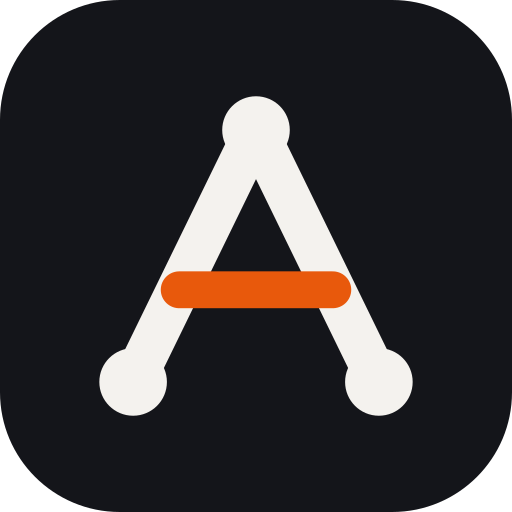

# Brand

> **Applies to:** Arestrix Beta 1.0 (`1.0.0-beta.1`) · Last reviewed: 2026-10-19

[Português](../pt-BR/marca.md) · [Index](../README.md)

How Arestrix looks, summarized from the **Brand Manual v1.0 (October 2026)**. The full manual, with
all logo, icon, social and favicon files, is kept outside the repository (`Manual_de_Marca/` is
git-ignored). The few logo files used by the READMEs are copied to `docs/assets/`.

## The A is a graph

*Arestrix* comes from *aresta* (edge), the link between two vertices of a graph. The first letter of the name
is drawn as the object the tool orchestrates: tasks connected by dependencies.

| Part | Meaning |
| :--- | :--- |
| Three nodes | Tasks: the top starts the flow, the bases receive it. |
| The two legs | Dependencies (edges) that connect the tasks. |
| The Brasa bar | The **decision edge**, where the flow branches. It is the only color of the mark. |

### Construction

- The height of the A is the cap height of Space Grotesk Bold; the symbol sits on the text baseline.
- Legs are 14% of the height thick, with rounded ends. The bar is 12% of the height, 61% down from the
  top, between (25, 61) and (75, 61). Nodes have a radius of 11% of the height.
- **Below 32 px the nodes are removed** (the simplified version, with thicker legs).
- The all-caps version has legs 20% thicker, to balance the capitals.

## Logo versions

| Version | Use | File |
| :--- | :--- | :--- |
| **Positive** | On Papel or white. Default for product, site, docs and repository. | [`arestrix-logo.svg`](../assets/arestrix-logo.svg) |
| **Negative** | On Grafite or dark backgrounds. | [`arestrix-logo-reverse.svg`](../assets/arestrix-logo-reverse.svg) |
| **Black** | One-color print and stamps. | manual only |
| **White** | On Brasa or dark photography. | manual only |
| **Icon** | The A alone, Papel on Grafite, corners 23% of the side. | [`arestrix-icon.svg`](../assets/arestrix-icon.svg) |

The README switches between positive and negative according to the reader's theme.

### Clear space and minimum size

- Clear space **x** = half the height of the A. No text, border or image may enter that margin around the logo.
- Minimum logo width: **96 px** on screen, **25 mm** in print. The symbol alone: **16 px**.

## Colors

| Name | Hex | RGB | CMYK | Use |
| :--- | :--- | :--- | :--- | :--- |
| **Grafite** | `#14151A` | 20 21 26 | 23 19 0 90 | Dark surfaces, icon background. |
| **Papel** | `#F4F2EE` | 244 242 238 | 0 1 2 4 | Light surfaces, strokes and nodes. |
| **Brasa** | `#E8590C` | 232 89 12 | 0 62 95 9 | The decision edge and occasional highlights only. |
| **Ardósia** | `#4B4F5C` | 75 79 92 | 19 14 0 64 | Secondary text and neutrals. |

Brasa has a contrast of only **3.2:1** on Papel: use it for graphic elements and for text above 24 px.

## Typography

Both families are under the SIL Open Font License. In Office documents without them installed, use Arial.

| Role | Font | Weight |
| :--- | :--- | :--- |
| Titles and logo | **Space Grotesk** | 700, letter spacing -3.5% on large titles |
| Text and interface | **Space Grotesk** | 500 |
| Code and technical signature | **IBM Plex Mono** | 500 |

## Incorrect uses

Do not distort the proportions · do not rotate the logo · do not change the color of the edge · do not
separate the A from the name · do not use low-contrast backgrounds · do not convert to outline.

## In this repository

Colors and fonts are the CSS variables `--brand-grafite`, `--brand-papel`, `--brand-brasa`,
`--brand-ardosia`, `--font-display` and `--font-tech` in `src/styles/soft-neomorphic-theme.css`. The
browser tab uses the favicon from `index.html`. In the interface, text never carries a shadow or glow.

## Related

- [Interface tour](interface.md)
