# Feature showcase

> **Applies to:** Arestrix 2.5 (`2.5.0`) · Last reviewed: 2026-10-31

## 1. Studio canvas and agent swarm

The Studio uses an Office-inspired ribbon and an infinite canvas. A running pipeline shows
completed and active vertices, live thinking telemetry, the C++20 Taskflow build terminal and the
agent inspector.

## 2. Native C++20 Taskflow generation

Generated C++20 source is available in the embedded Monaco editor. Parallel branches map to
concurrent Taskflow tasks, and the generated project can be compiled and inspected outside the
Studio.

## 3. Standalone runner

The exported runner gives non-technical operators a focused execution screen with a progress
timeline, node indicators and iteration history.

## 4. Telemetry and diagnostics

Execution diagnostics include node latency, token throughput, live model reasoning streams and
tool argument inspection.

## 5. Governance and enterprise export

The export flow configures credential vaults (Windows DPAPI or Azure Key Vault), generates the
integrity manifest and prepares MSI/MSIX packaging for managed Windows deployment.

## 6. Office Properties hub

The Backstage **Properties** hub brings the three configuration scopes into one Office-style
surface. Each scope opens the same shared shell with left navigation, content cards and a fixed
Cancel/Save footer.

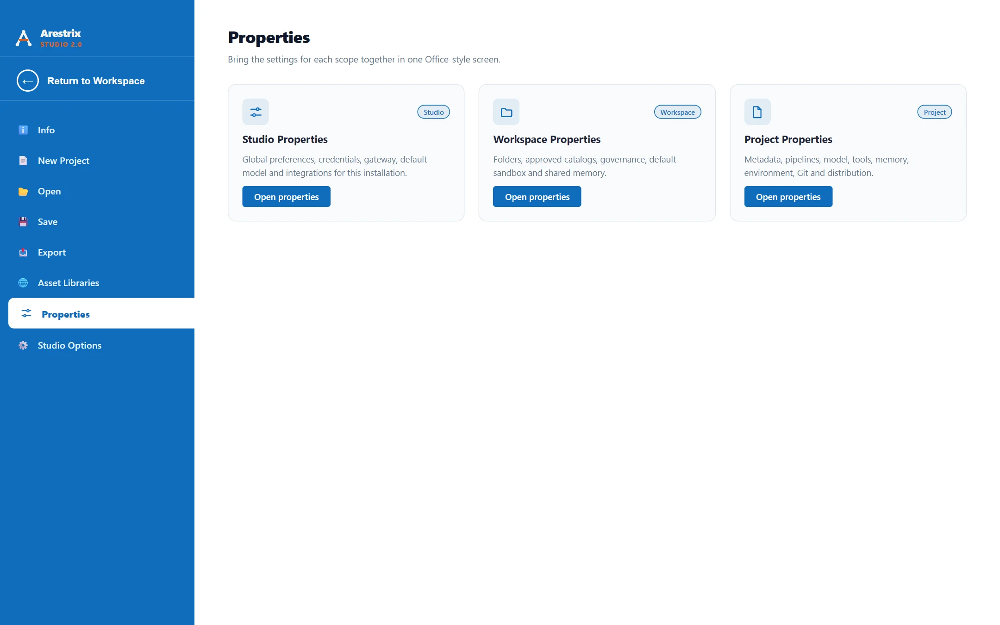

### Studio Properties

Language, theme, canvas, default model, credentials, AI Gateway and advanced reset live in the
Studio scope. Provider keys remain write-only status fields.

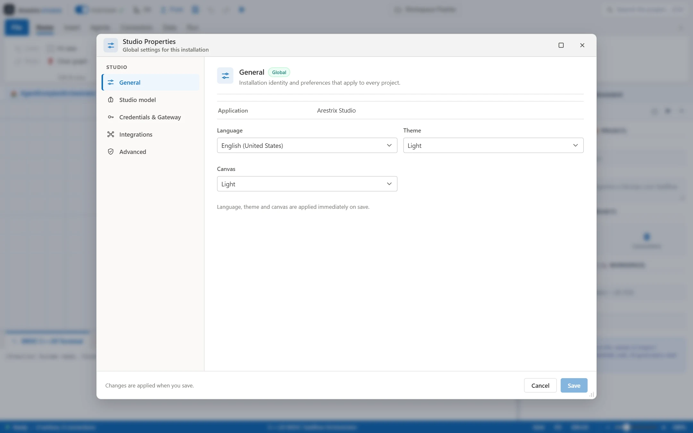

## 7. Workspace and Project Properties

The Workspace owns the default sandbox and audit policy. The Project owns the manifest, model/tools
defaults, sanitized environment references and SQLite path.

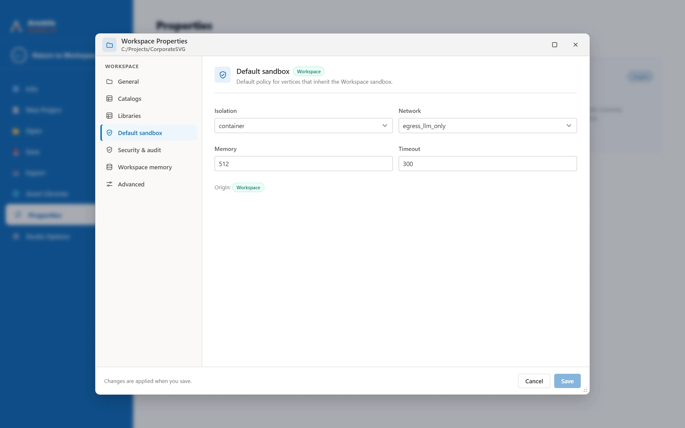

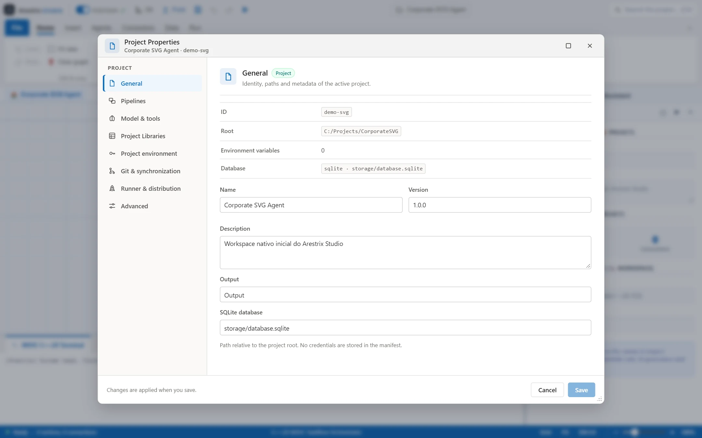

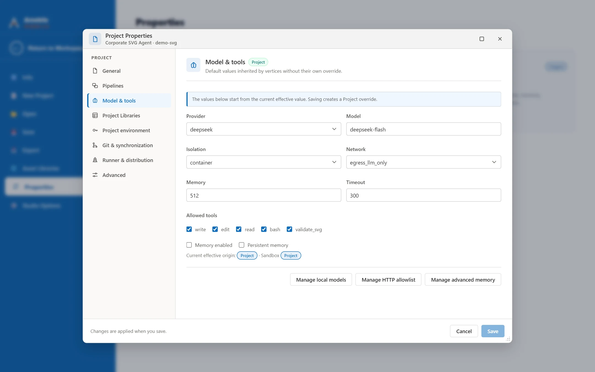

## 8. Light and dark themes

Choose **Light**, **Dark** or **Follow system** in Studio Properties. The theme applies to the
ribbon, task pane, console, Backstage and Office dialogs; the canvas background remains an
independent preference.

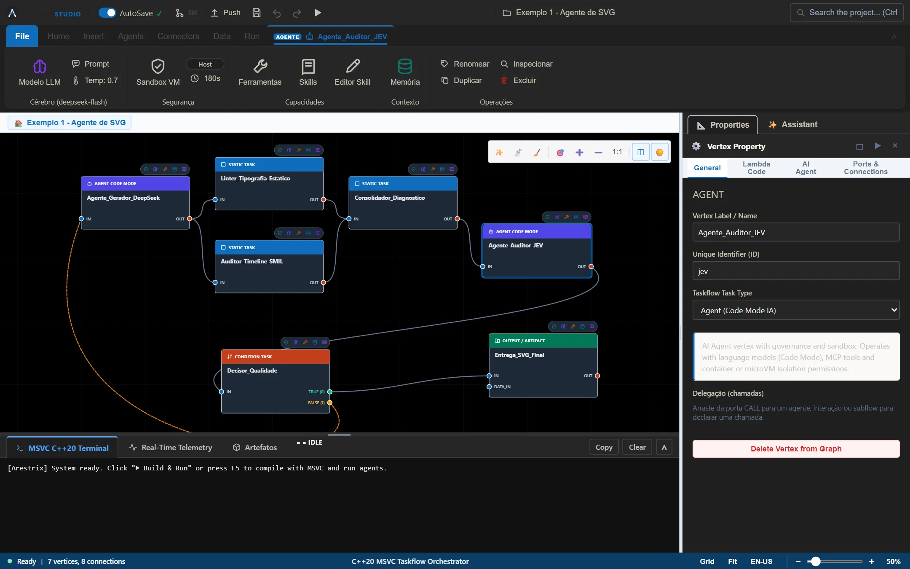

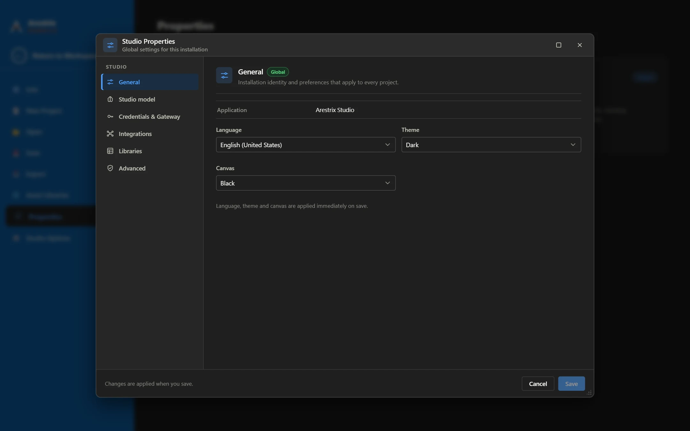

## 9. Vertex dialogs in the shared Office shell

Sandbox, model, tools and memory dialogs for a vertex now use the same `BaseModal` shell as the
Properties screens, while keeping explicit inheritance and per-vertex overrides.

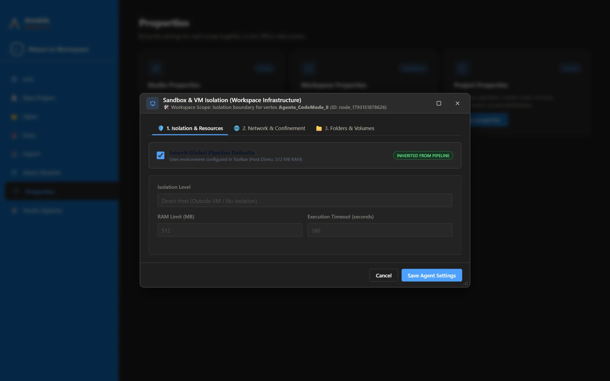

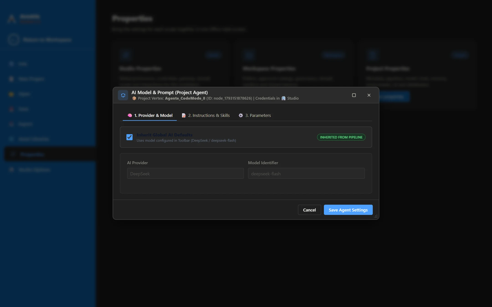

## 10. Office-style Open screen

The **Open** screen follows the Office layout: locations on the left, a search box on the right and
a table with Name, Date modified, Type and Size columns. Recent groups keep the Office
Today/Yesterday/Last week organisation.

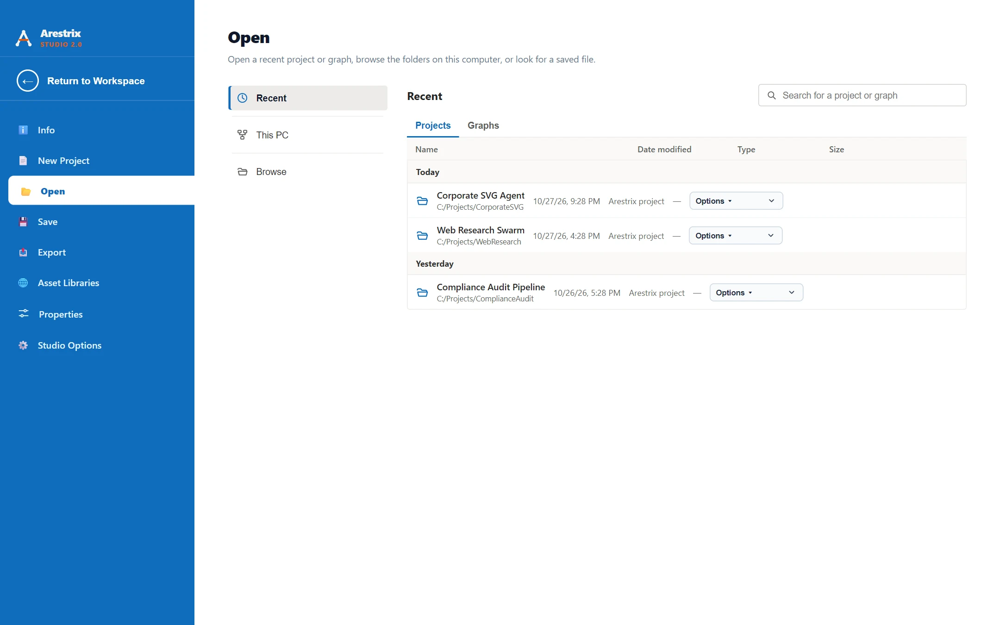

## 11. Office File menu pages

The rest of the File menu was aligned with the same Office shell: **Info** uses summary cards and an Office recent-projects table, **New Project** uses a single details form, and **Save**, **Export** and **Options** use action cards, vector icons and Office buttons. **Studio Options** is now a settings hub for Studio, Workspace and catalogs, while the execution actions stay in place.

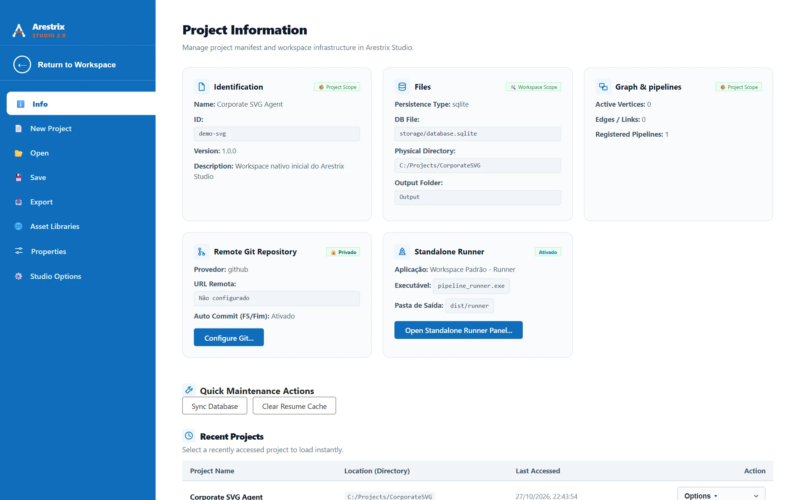

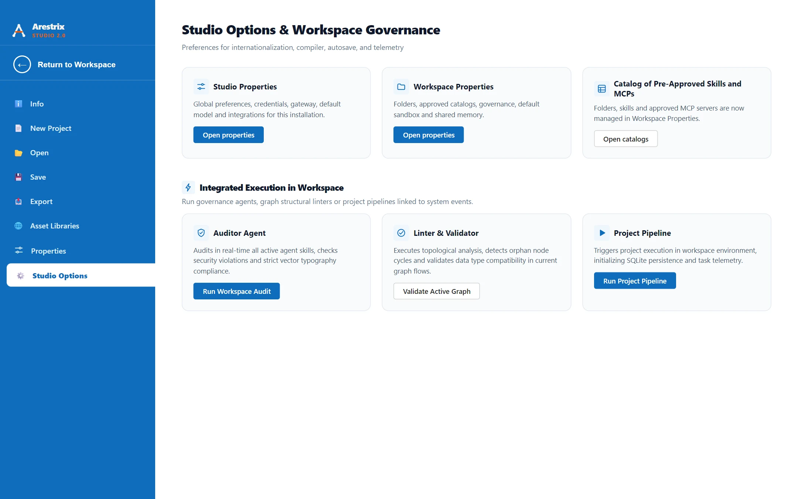

## 12. Libraries and GitHub sources

The Arestrix Library is the audited source of skills, MCPs and templates. Studio and Workspace share the library browser, project pins and the **Repository sources (GitHub)** panel at the top: register `organization/project`, branch/tag, license and description, save, then select the linked library and sync the manifest. Asset contents are downloaded on demand and audited before installation.

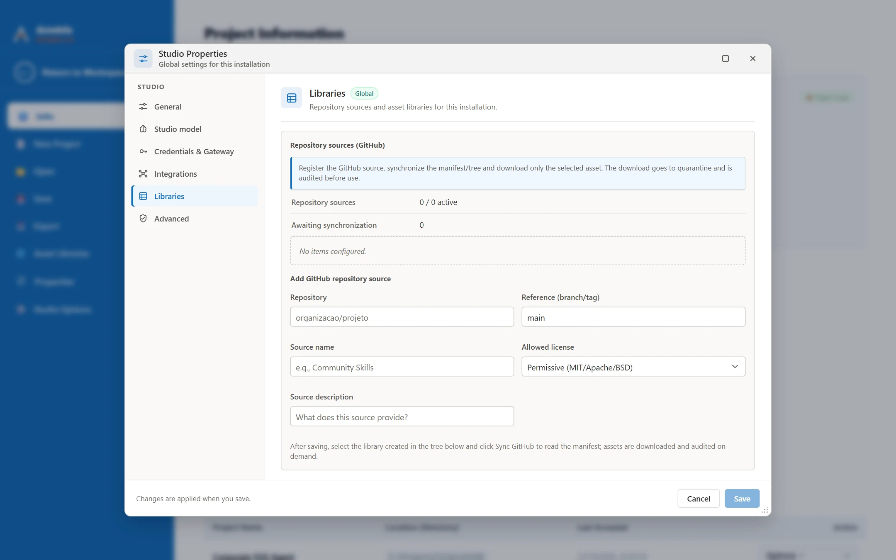

> Screenshots are captured from the development build. Interface details may change during the
> beta. Regenerate them with `npm run capture:screenshots`.
