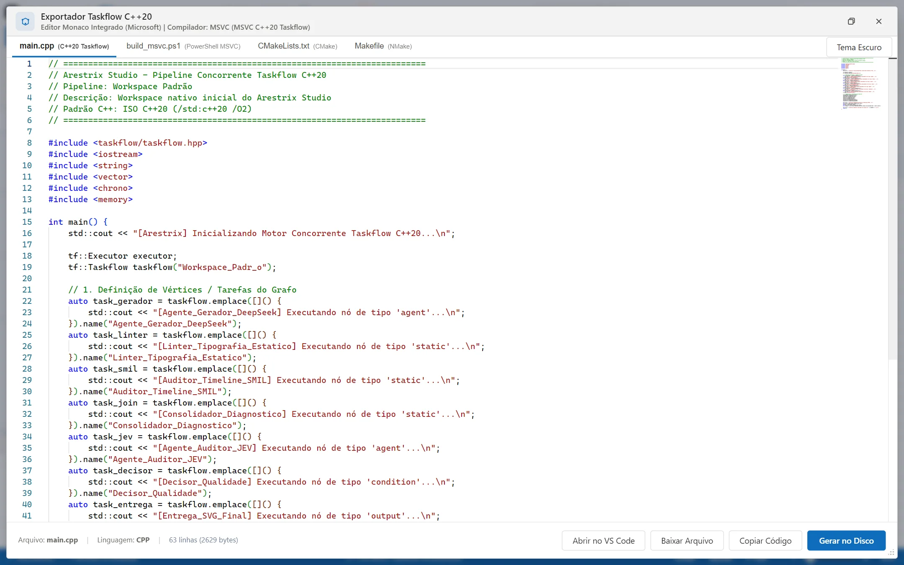
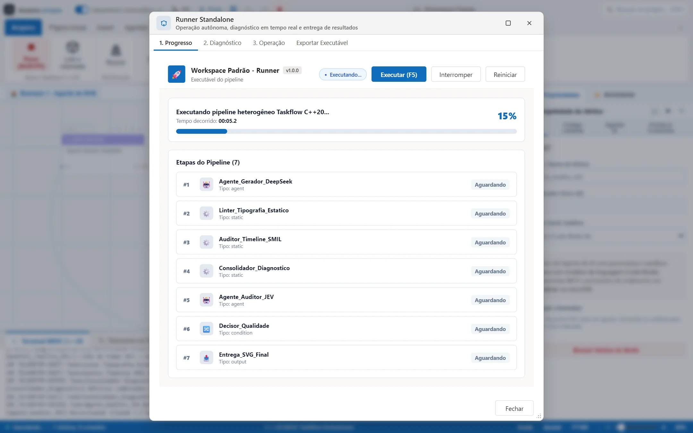
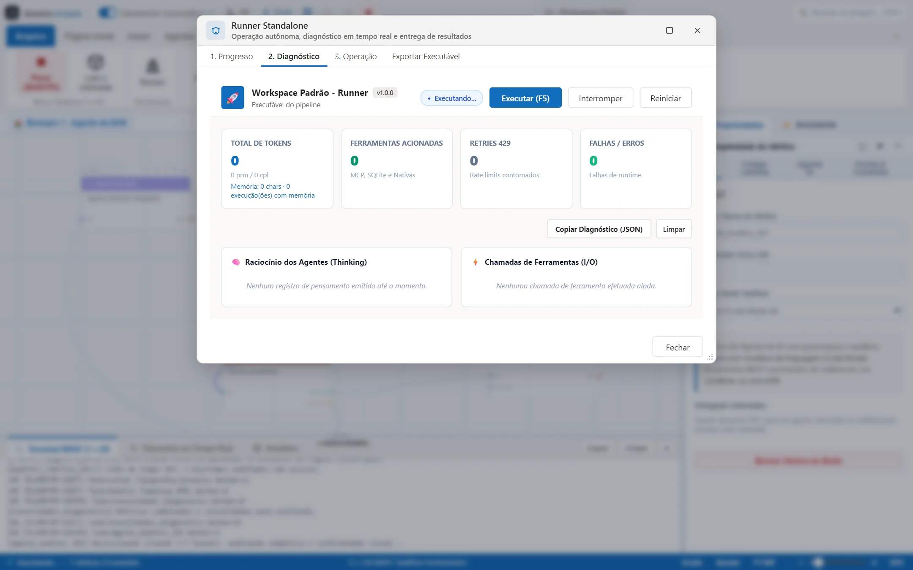
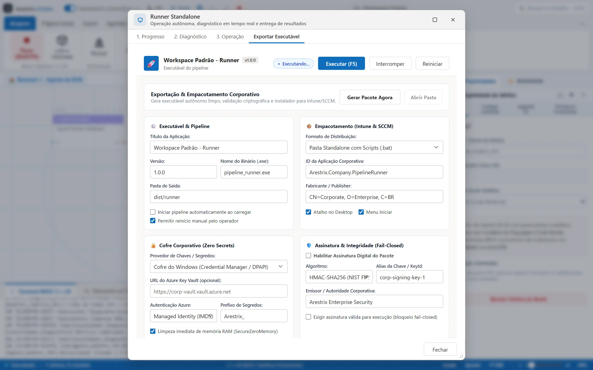

# Feature showcase

> **Applies to:** Arestrix Beta 2 (`2.0.0-beta.1`) · Last reviewed: 2026-10-19

## 1. Studio canvas and agent swarm

The Studio uses an Office-inspired ribbon and an infinite canvas. A running pipeline shows
completed and active vertices, live thinking telemetry, the C++20 Taskflow build terminal and the
agent inspector.

## 2. Native C++20 Taskflow generation

Generated C++20 source is available in the embedded Monaco editor. Parallel branches map to
concurrent Taskflow tasks, and the generated project can be compiled and inspected outside the
Studio.

## 3. Standalone runner

The exported runner gives non-technical operators a focused execution screen with a progress
timeline, node indicators and iteration history.

## 4. Telemetry and diagnostics

Execution diagnostics include node latency, token throughput, live model reasoning streams and
tool argument inspection.

## 5. Governance and enterprise export

The export flow configures credential vaults (Windows DPAPI or Azure Key Vault), generates the
integrity manifest and prepares MSI/MSIX packaging for managed Windows deployment.

> Screenshots are captured from the development build. Interface details may change during the
> beta. Regenerate them with `npm run capture:screenshots`.
