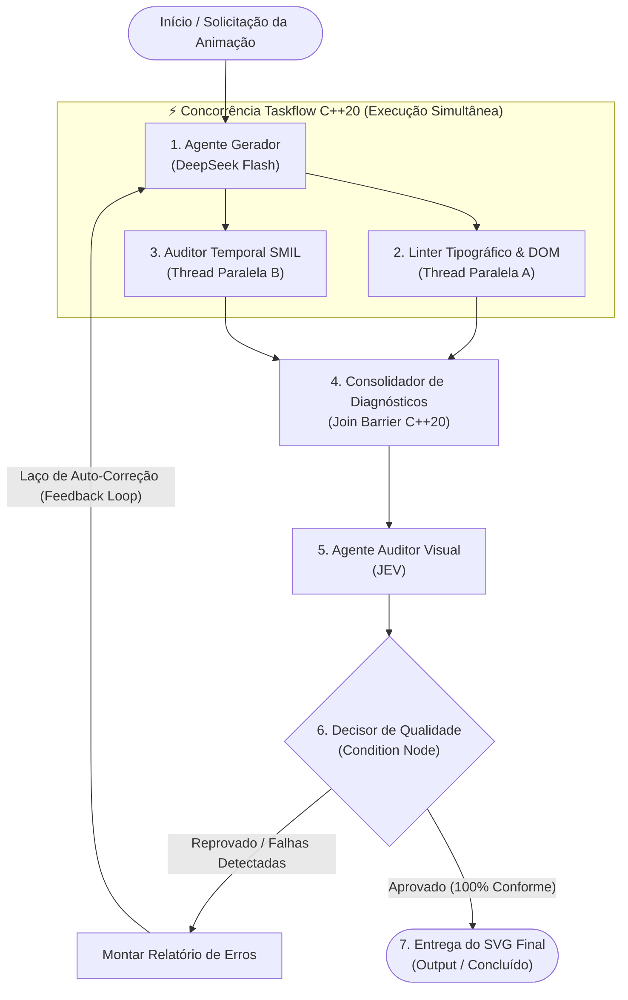

# ⚡ Tutorial Arestrix: Agente Auditor e Criador de SVGs Animados

> **Aplica-se a:** Arestrix Beta 2.3 (`2.3.0-beta.2`) · Última revisão: 2026-10-19

## Guia Didático para Iniciantes: Orquestração Cognitiva e Concorrência C++20 com Taskflow

---

## 🎯 Visão Geral do Documento

Este documento serve como um **guia introdutório completo ao Arestrix**, a plataforma visual para modelagem e execução de grafos de agentes concorrentes baseados em **Taskflow C++20**.

Você aprenderá a criar do absoluto zero um **Agente de Engenharia e Auditoria de SVGs Animados**. Este agente resolve um problema real onde a maioria dos modelos de linguagem falha: a geração de gráficos vetoriais animados que respeitam regras estritas de design visual, timing temporal contínuo e integridade técnica.

### 🧩 Os Modelos no Fluxo: Especialização Cognitiva
Para maximizar a relação entre velocidade, custo e rigor técnico, dividimos o trabalho entre dois modelos distintos:
1. **DeepSeek Flash**: Atua na **Geração e Raciocínio Rápido** (Passo 1 e Correções). É ágil, altamente capacitado em geração de código sintático e manipulação matemática de vetores e timelines.
2. **JEV**: Atua na **Auditoria Visual e Verificação** (Passo 5). Uma engine/modelo especializada em inspeção visual e semântica, responsável por avaliar se o SVG atende aos requisitos estéticos, legibilidade e conformidade com as regras de projeto antes de aprovar a entrega.

### ⚡ Por que usar Taskflow C++20? (A Justificativa da Concorrência)
Em sistemas de agentes de produção, a verificação não pode ser um gargalo sequencial lento. Nosso agente executa **duas threads paralelas de validação**:
* **Thread A (Linter Tipográfico & Estático)**: Inspeciona a árvore DOM, valida a sintaxe XML, coordenadas do `viewBox` e audita a regra inegociável de tipografia.
* **Thread B (Auditor Temporal SMIL / Keyframes)**: Analisa o encadeamento temporal, detecta referências órfãs de IDs em gatilhos (`begin="anim.end"`), durações inconsistentes e o congelamento de estado final (`fill="freeze"`).

O motor nativo **Taskflow C++20** do Arestrix despacha essas tarefas para o pool de threads assíncronas do sistema operacional, executando a análise simultaneamente antes de entregar o relatório consolidado ao avaliador.

---

## 📐 Parte 1: Conceito e Arquitetura do Agente

### 1.1 O Desafio dos SVGs Animados
Criar um SVG estático é trivial; animá-lo, contudo, introduz **três variáveis complexas**:
1. **Encadeamento Temporal**: Animações em SVG (SMIL `<animate>`, `<animateTransform>` ou CSS `@keyframes`) dependem de sincronia entre etapas (ex: a seta só pode se expandir após a caixa anterior surgir).
2. **Transformações de Coordenadas**: Escalar ou rotacionar um elemento sem configurar o pivô ou `transform-origin` adequado faz com que o objeto seja projetado para fora da tela.
3. **Ordem de Renderização (Z-Index)**: No padrão SVG, o que está desenhado por último fica por cima. Se um fundo de destaque for animado e inserido depois do texto, ele encobrirá a leitura.

### 1.2 A Regra Global de Tipografia (Inegociável)
Para manter alta legibilidade e nitidez visual, o projeto adota uma diretriz estrita:

> 🚫 **PROIBIÇÃO DE SOMBRAS E GLOWS EM TEXTO**:
> **NUNCA** utilizar efeitos de sombra ou brilho (`filter: drop-shadow(...)`, `text-shadow`, ou filtros SVG como `<feDropShadow>` e `<feGaussianBlur>`) em elementos de texto (`<text>`, fontes, números, legendas ou labels) para destacar foco ou etapas ativas.
>
> ✨ **ALTERNATIVAS OBRIGATÓRIAS**:
> 1. **Pílula / Badge de Fundo Limpo**: Inserir um `<rect>` com cantos arredondados (`rx="4"`) e opacidade suave **atrás** do texto no DOM.
> 2. **Cor de Contraste**: Trocar a cor do `fill` do texto para uma cor de destaque da paleta.
> 3. **Peso Tipográfico**: Elevar para `font-weight: 700` ou `800`.
> 4. **Contraste de Opacidade**: Manter o elemento em foco em `opacity: 1.0` e atenuar os secundários em `opacity: 0.4`.

### 1.3 O Grafo de Execução (DAG)
O fluxo do agente é estruturado como um Grafo Acíclico Dirigido (DAG) com laço de feedback deliberativo (ReAct):



---

## 🖥️ Parte 2: Passo a Passo no Arestrix Studio

Suponha que você acabou de abrir o Arestrix pela primeira vez. Não se preocupe: cada passo abaixo indica exatamente onde clicar na interface.

### 2.0 Antes de Executar: Chaves, Pastas e Limites

Para o **Build & Run (F5)** funcionar de ponta a ponta (veja também o README):

1. **Compilador C++20**: Visual Studio com a carga "Desenvolvimento para Desktop com C++" (Windows) ou `g++`/`clang++` (Linux). O Arestrix gera o `main.cpp`, compila e executa dentro da **pasta do projeto ativo**.
2. **Chaves de API** (variáveis de ambiente do usuário, gravadas em *Propriedades → Studio → Credenciais e Gateway*):
   * `DEEPSEEK_API_KEY` para o `Agente_Gerador_DeepSeek`.
   * `JEV_BASE_URL` (endereço do servidor compatível com a API OpenAI que serve o JEV) e, se ele exigir, `JEV_API_KEY` para o `Agente_Auditor_JEV`.
   * Modelo local em vez de API paga? Use o provedor `local` (`LOCAL_LLM_BASE_URL`, padrão `http://localhost:11434/v1`).
3. **Caminhos relativos**: `workspace/scene.svg` e os demais arquivos do tutorial ficam dentro da pasta do projeto; as ferramentas `read`/`write` dos agentes **não conseguem sair dela**.
4. **Ferramentas vêm da configuração do nó**: a lista `tools:` no cabeçalho do `SKILL.md` é apenas informativa. Quem autoriza `write`, `read` e `validate_svg` é o modal *Ferramentas* do vértice ou *Propriedades → Projeto → Modelo e ferramentas*. O auditor JEV precisa de `write`, pois grava `audit_decision.txt`.
5. **Limite de segurança do laço**: cada agente roda no máximo 10 vezes por execução (`ARESTRIX_MAX_AGENT_RUNS`), para que um laço de auto-correção que não converge não gaste dinheiro indefinidamente. `Shift+F5` interrompe a execução.
6. **Sem internet ou sem chaves?** O teste automatizado `python scripts/e2e_tutorial.py` executa este mesmo grafo contra um servidor LLM de mentira.

### 2.1 Conhecendo o Ambiente de Trabalho
Ao abrir o **Arestrix Studio**, você verá:
1. **Faixa de Opções (Office Ribbon)** no topo: contendo as abas *Arquivo*, *Página Inicial*, *Inserir*, *Agentes & Tools*, etc.
2. **Canvas 2.5D Central**: uma área infinita acelerada por WebGL onde os vértices e conexões são desenhados.
3. **Barra de Ferramentas e Status**: botões de zoom, histórico (*Desfazer/Refazer*) e status de execução no rodapé.

---

### Passo 1: Limpar o Canvas e Configurar os Padrões do Projeto

1. Na aba **Página Inicial** da Ribbon, clique no botão **Limpar Grafo** (ícone de lixeira) para começar com uma folha limpa.
2. Abra **Arquivo → Propriedades → Projeto → Modelo e ferramentas**.
3. Na tela de Propriedades:
   * **Provedor**: Selecione `DeepSeek`.
   * **Modelo**: Digite `deepseek-flash`.
   * **Isolamento**: Escolha `host_direct` para prototipagem rápida.
   * **Ferramentas permitidas**: Marque `write`, `read` e `validate_svg`.
4. Clique em **Salvar**.

---

### Passo 2: Criar o Vértice Gerador (`Agente_Gerador_DeepSeek`)

Este vértice será o cérebro criador da animação.

1. Na aba **Página Inicial** ou **Inserir**, clique no botão grande **+ Agente IA** (`🤖`).
2. Um novo cartão de vértice aparecerá no centro do canvas.
3. Clique duas vezes sobre o título do nó para renomeá-lo: digite `Agente_Gerador_DeepSeek`.
4. No cartão do nó, localize e clique no ícone **`🧠` (Modelo & Prompt)**:
   * **Herdar Padrões Globais**: Pode manter marcado (já configuramos o `deepseek-flash`), ou desmarque para garantir explicitamente `Provedor: DeepSeek` e `Modelo: deepseek-flash`.
   * Clique no botão **Editar Skill (.md)** para abrir o editor de habilidades.
   * Cole as instruções de sistema descritas na [Seção 3.1](#31-skill-do-gerador-deepseek-flash).
   * Pressione `Ctrl + S` para salvar a habilidade e fechar o editor.
5. Agora clique no ícone **`🔧` (Ferramentas)** do nó e certifique-se de que a ferramenta `write` e `read` estão autorizadas.

---

### Passo 3: Criar o Fork Paralelo com Taskflow (As Duas Threads)

Aqui criaremos as duas tarefas C++ que rodarão em paralelo via Taskflow.

#### Criando a Thread A: Linter Tipográfico & DOM
1. Na aba **Inserir**, clique em **Tarefa Estática** (`⏹️`).
2. Posicione o nó à direita e um pouco acima do gerador.
3. Renomeie o nó para `Linter_Tipografia_Estatico`.
4. Dê um clique duplo no corpo do nó ou abra suas propriedades no painel lateral (Inspetor).
5. No campo **Corpo da Função C++ (Lambda)**, insira o código determinístico que analisa o SVG em busca de violações tipográficas (veja o código C++ na [Seção 3.2](#32-código-da-thread-a-linter-tipográfico)).

#### Criando a Thread B: Auditor Temporal SMIL
1. Na aba **Inserir**, clique novamente em **Tarefa Estática** (`⏹️`).
2. Posicione o nó abaixo da Thread A.
3. Renomeie o nó para `Auditor_Timeline_SMIL`.
4. No campo **Corpo da Função C++ (Lambda)**, insira o código que valida a consistência das tags de animação (veja na [Seção 3.3](#33-código-da-thread-b-auditor-temporal-smil)).

#### Conectando o Fork:
1. Passe o mouse sobre a porta de saída (`out`) do nó `Agente_Gerador_DeepSeek`.
2. Clique e arraste a linha Bézier até a porta de entrada (`in`) do nó `Linter_Tipografia_Estatico`.
3. Repita o processo: clique novamente na saída (`out`) do `Agente_Gerador_DeepSeek` e arraste até a entrada (`in`) do `Auditor_Timeline_SMIL`.
*Pronto! Você acabou de instruir o Taskflow C++20 a disparar essas duas tarefas simultaneamente assim que o gerador terminar!*

---

### Passo 4: Criar o Ponto de Junção (Join Barrier)

No modelo DAG, precisamos que a execução espere ambas as threads terminarem antes de chamar o auditor.

1. Na aba **Inserir**, clique em **Tarefa Estática** (`⏹️`).
2. Posicione o nó à direita das duas threads.
3. Renomeie o nó para `Consolidador_Diagnostico`.
4. Conecte a saída (`out`) do `Linter_Tipografia_Estatico` na entrada (`in`) do `Consolidador_Diagnostico`.
5. Conecte a saída (`out`) do `Auditor_Timeline_SMIL` na entrada (`in`) do `Consolidador_Diagnostico`.
*O Taskflow tratará esse nó automaticamente como uma barreira de sincronização (`A.precede(Join)` e `B.precede(Join)`).*

---

### Passo 5: Criar o Vértice de Verificação com JEV (`Agente_Auditor_JEV`)

Agora inserimos o auditor especializado com o modelo JEV.

1. Na aba **Inserir**, clique em **+ Agente IA** (`🤖`).
2. Posicione-o à direita do `Consolidador_Diagnostico`.
3. Renomeie o nó para `Agente_Auditor_JEV`.
4. Conecte a saída do `Consolidador_Diagnostico` na entrada do `Agente_Auditor_JEV`.
5. No cartão do nó, clique no ícone **`🧠` (Modelo & Prompt)**:
   * Desmarque a opção **Herdar Padrões Globais de IA**.
   * No campo **Provedor de IA**, selecione **Jev / Engine Visual** (`jev`).
   * No campo **Identificador do Modelo**, digite `jev-visual-evaluator`.
   * Clique em **Editar Skill (.md)** e cole o conteúdo da [Seção 3.4](#34-skill-do-auditor-jev).
   * Salve com `Ctrl + S`.

---

### Passo 6: Criar a Condição de Qualidade e o Laço de Feedback

Este é o componente que transforma a execução em um **Agente Autônomo com auto-observação e auto-correção**.

1. Na aba **Inserir**, clique em **Condição (Branch)** (`🔀`).
2. Posicione o nó de condição logo à direita do `Agente_Auditor_JEV`.
3. Renomeie o nó para `Decisor_Qualidade`.
4. Conecte a saída do `Agente_Auditor_JEV` na entrada do `Decisor_Qualidade`.
5. O nó de condição possui duas saídas:
   * **Saída 0 (branch 0)**: Caminho do Sucesso / Aprovado.
   * **Saída 1 (branch 1)**: Caminho da Falha / Reprovado.

#### Configurando o Sucesso (Entrega Final / Nó Output):
1. Na aba **Inserir**, clique no botão **Saída / Artefato** (`📁` / `output`) para criar um nó de entrega.
2. Posicione o nó à direita do `Decisor_Qualidade` e renomeie-o para `Entrega_SVG_Final`.
3. No painel lateral **Inspetor**, configure o bloco **Configuração de Saída / Artefato**:
   * **Arquivo Origem (sourcePath)**: `workspace/scene.svg`
   * **Arquivo Destino (destinationPath)**: `exports/scene.svg`
   * **Tipo de Artefato**: `SVG Vector`
   * **Nome de Exibição**: `Cena SVG Animada Final`
   * **Abrir Prévia Automaticamente**: Marcado (ativo)
4. Conecte o **branch 0** do `Decisor_Qualidade` na porta `in` do nó `Entrega_SVG_Final`.

#### Configurando o Feedback Loop (Auto-Correção):
1. Clique no **branch 1** (Reprovado) do `Decisor_Qualidade`.
2. Arraste a conexão de volta para a porta de entrada (`in`) do primeiro nó: `Agente_Gerador_DeepSeek`!
*Uma linha de conexão curva fechará o circuito. O Arestrix interpretará isso como um ciclo condicional de replanejamento no DAG.*

---

### Passo 7: Validar, Compilar e Visualizar os Produtos

1. Na Ribbon, aba **Página Inicial**, clique em **Validar DAG** (`🔍`).
   * O Arestrix analisará a topologia, garantindo que as portas estão devidamente conectadas e que o ciclo de feedback está governado por uma condição estocástica válida.
2. Pressione a tecla **F5** ou clique no botão **Build & Run (F5)** (`▶`).
   * O backend C++ invocará o compilador MSVC C++20 (`cl.exe`), gerando o binário nativo com a biblioteca Taskflow.
   * No painel de console inferior, você verá a telemetria em tempo real: o DeepSeek gerando o código, as duas threads rodando em núcleos separados, o JEV auditando a cena e o nó `Entrega_SVG_Final` copiando o artefato de `workspace/scene.svg` para `exports/scene.svg`.
3. **Inspecionando os Produtos na Aba Artefatos**:
   * O Arestrix abrirá automaticamente a aba **Artefatos** (ao lado de Terminal e Telemetria) exibindo o `exports/scene.svg`.
   * Você poderá interagir diretamente com a animação: aplicar zoom, pan, alternar entre a renderização visual e a inspeção do código XML, baixar o arquivo, copiar seu código ou clicar em **Abrir no Explorer**.
   * Você também pode interagir com o assistente do chat local perguntando: *"Quais artefatos foram produzidos nesta execução?"* e ele usará a ferramenta `list_artifacts` para inspecionar e relatar os entregáveis.

---

### Passo 8: Ver o Código C++20 Gerado

Deseja inspecionar o código fonte C++ que o Arestrix produziu nos bastidores?
1. Clique na aba **Arquivo** na Ribbon para abrir a **Backstage View**.
2. Clique na opção **Exportar**.
3. O modal de exportação abrirá com o editor de código em tela cheia:
   * Na aba **main.cpp**: você verá a estrutura de tarefas `tf::Taskflow`, o agendamento `executor.run(taskflow)` e os nós de condição.
   * Na aba **CMakeLists.txt / Makefile**: o arquivo de compilação C++20 pronto para distribuição.
   * Na aba **Arquitetura Visual SVG**: o diagrama vetorial da sua arquitetura gerado pelo Graphviz.

---

## 💻 Parte 3: Códigos, Prompts e Scripts do Pipeline

Abaixo estão os modelos de texto e código para você copiar e colar diretamente nos nós do Arestrix.

### 3.1 Skill do Gerador (`DeepSeek Flash`)
Abra o **`🧠` Modelo & Prompt** do `Agente_Gerador_DeepSeek`, abra o **Editar Skill** e cole:

```markdown
---
name: "SVG_Animation_Architect"
description: "Especialista em síntese de SVGs animados estruturados com SMIL e CSS keyframes"
license: "MIT"
tools:
  - write
  - read
---

# SVG Animation Architect (DeepSeek Flash)

Você é um engenheiro de computação gráfica especializado em gráficos vetoriais escaláveis animados (SVG).

## Diretrizes Inegociáveis
1. **Regra Tipográfica**: NUNCA utilize filtros de desfoque, brilho ou sombra (como feGaussianBlur, feDropShadow, text-shadow ou filter: drop-shadow) em elementos de texto (<text>, números ou títulos).
   * Para destacar elementos em foco durante a animação, utilize uma das alternativas:
     a) Crie um elemento <rect> com cantos arredondados (rx="4") colocado ANTES do <text> no DOM, animando sua opacidade de 0 para 1.
     b) Altere a cor do fill do texto para uma cor vibrante da paleta.
     c) Atenue os elementos inativos alterando sua opacidade para 0.4.
2. **SMIL & Timelines**:
   * Sempre defina o atributo `id` em elementos que disparam outros (`begin="animId.end + 0.2s"`).
   * Utilize `fill="freeze"` nas animações que devem reter o estado final após a execução.
   * Em <animateTransform type="scale">, sempre forneça o centro de escala para não deslocar o objeto.
3. **Persistência**: Grave o resultado no arquivo compartilhado `workspace/scene.svg`.
```

---

### 3.2 Código da Thread A (Linter Tipográfico & DOM)
Cole no campo **Custom Lambda Body** do nó `Linter_Tipografia_Estatico`:

```cpp
// Thread A: Linter Tipográfico e de Estrutura DOM (C++20)
std::cout << "[Thread A] Iniciando auditoria tipográfica no SVG...\n";

std::ifstream file("workspace/scene.svg");
if (!file.is_open()) {
    std::cerr << "[Thread A - ERRO] Arquivo workspace/scene.svg não encontrado!\n";
    return;
}

std::string content((std::istreambuf_iterator<char>(file)), std::istreambuf_iterator<char>());
file.close();

bool violation = false;
// Verificação de conformidade de regras de projeto
if (content.find("feGaussianBlur") != std::string::npos ||
    content.find("feDropShadow") != std::string::npos ||
    content.find("text-shadow") != std::string::npos) {
    std::cout << "[Thread A - VIOLAÇÃO] Detectado filtro de sombra ou blur! Proibido em elementos de texto.\n";
    violation = true;
}

// Grava relatório da Thread A no quadro compartilhado (blackboard)
std::ofstream report("workspace/report_thread_a.txt");
report << (violation ? "FAIL: VIOLACAO_TIPOGRAFIA_DETECTADA" : "PASS: TIPOGRAFIA_LIMPA");
report.close();

std::cout << "[Thread A] Auditoria concluída.\n";
```

---

### 3.3 Código da Thread B (Auditor Temporal SMIL)
Cole no campo **Custom Lambda Body** do nó `Auditor_Timeline_SMIL`:

```cpp
// Thread B: Auditor Temporal e Animações SMIL (C++20)
std::cout << "[Thread B] Iniciando auditoria de timelines e encadeamentos SMIL...\n";

std::ifstream file("workspace/scene.svg");
std::string content((std::istreambuf_iterator<char>(file)), std::istreambuf_iterator<char>());
file.close();

bool timing_ok = true;

// Checagem de congelamento de estado final
if (content.find("<animate") != std::string::npos && content.find("fill=\"freeze\"") == std::string::npos) {
    std::cout << "[Thread B - ALERTA] Animação detectada sem retenção de estado (fill=\"freeze\").\n";
    timing_ok = false;
}

// Checagem de escala sem pivô central
if (content.find("type=\"scale\"") != std::string::npos && content.find("transform-origin") == std::string::npos) {
    std::cout << "[Thread B - ALERTA] animateTransform scale sem pivô explícito detectado.\n";
    timing_ok = false;
}

std::ofstream report("workspace/report_thread_b.txt");
report << (timing_ok ? "PASS: TIMELINE_SMIL_CONSISTENTE" : "WARN: TIMELINE_INSTAVEL");
report.close();

std::cout << "[Thread B] Análise de timeline concluída.\n";
```

---

### 3.4 Skill do Auditor (`JEV`)
Abra o **`🧠` Modelo & Prompt** do `Agente_Auditor_JEV`, selecione o provedor `Jev / Engine Visual`, abra o **Editar Skill** e cole:

```markdown
---
name: "JEV_Visual_Auditor"
description: "Auditor visual de qualidade estética, contraste, legibilidade e conformidade de animações"
license: "MIT"
tools:
  - read
---

# JEV Visual Auditor

Você é o avaliador e auditor de qualidade estética e técnica de gráficos vetoriais.

## Procedimento de Avaliação
1. Leia os diagnósticos gerados pelas threads em `workspace/report_thread_a.txt` e `workspace/report_thread_b.txt`.
2. Inspecione o código gerado em `workspace/scene.svg`.
3. **Critérios de Aceite**:
   * Se houver qualquer menção de `VIOLACAO_TIPOGRAFIA_DETECTADA` na Thread A: **REPROVAR IMEDIATAMENTE**.
   * Se a animação SMIL tiver nós desalinhados ou sobreposição de texto por pílulas: **REPROVAR**.
   * Se o contraste for perfeito, tipografia limpa (sem blur/sombra) e timeline estável: **APROVAR**.

## Saída Estruturada
Grave a decisão final em `workspace/audit_decision.txt`:
* Se aprovado: escreva exclusivamente `STATUS: APROVADO`
* Se reprovado: escreva `STATUS: REPROVADO` seguido de um resumo dos itens a corrigir para o DeepSeek.
```

---

### 3.5 Código C++20 do Decisor de Qualidade
Cole no campo **Custom Lambda Body** do nó de condição `Decisor_Qualidade`:

```cpp
// Leitura da decisão emitida pelo JEV
std::ifstream decisionFile("workspace/audit_decision.txt");
std::string status;
if (decisionFile.is_open()) {
    std::getline(decisionFile, status);
    decisionFile.close();
}

if (status.find("STATUS: APROVADO") != std::string::npos) {
    std::cout << ">>> [Decisor] JEV APROVOU o SVG! Conduzindo para entrega final.\n";
    return 0; // Ramo 0: Sucesso
} else {
    std::cout << ">>> [Decisor] JEV REPROVOU. Ativando laço de auto-correção para o DeepSeek Flash.\n";
    return 1; // Ramo 1: Re-planejamento
}
```

---

## 🚀 Parte 4: O Código C++20 Taskflow Gerado pelo Arestrix

Quando você clica em **Exportar**, este é o código C++20 com Taskflow que o Arestrix compila. Observe como as duas tarefas de linter são adicionadas ao fluxo e executadas concorrentemente de forma elegante:

```cpp
#include <taskflow/taskflow.hpp>
#include <iostream>
#include <fstream>
#include <string>

int main() {
    tf::Executor executor;
    tf::Taskflow taskflow("SVG_Agent_Pipeline");

    // 1. Nó do Agente Gerador (DeepSeek Flash)
    tf::Task generator = taskflow.emplace([]() {
        std::cout << "[1] Invocando DeepSeek Flash para sintetizar a animação SVG...\n";
        // Chamada de inferência ao modelo
    }).name("Agente_Gerador_DeepSeek");

    // 2. Thread Paralela A (Linter Tipográfico)
    tf::Task thread_a = taskflow.emplace([]() {
        std::cout << "[2A] Executando Linter Tipográfico em paralelo...\n";
        // Análise estática do DOM
    }).name("Linter_Tipografia_Estatico");

    // 3. Thread Paralela B (Auditor SMIL Temporal)
    tf::Task thread_b = taskflow.emplace([]() {
        std::cout << "[2B] Executando Auditor de Timelines em paralelo...\n";
        // Análise temporal das tags SMIL
    }).name("Auditor_Timeline_SMIL");

    // 4. Barreira de Sincronização (Join Barrier)
    tf::Task join_barrier = taskflow.emplace([]() {
        std::cout << "[3] Consolidando relatórios das duas threads paralelas...\n";
    }).name("Consolidador_Diagnostico");

    // 5. Nó de Verificação com JEV
    tf::Task auditor_jev = taskflow.emplace([]() {
        std::cout << "[4] Executando Auditoria Visual e de Critérios com JEV...\n";
    }).name("Agente_Auditor_JEV");

    // 6. Condição / Decisor de Qualidade (Branching)
    tf::Task condition = taskflow.emplace([&]() {
        // Retorna 0 para Sucesso, 1 para Reprovado (Loopback)
        std::ifstream f("workspace/audit_decision.txt");
        std::string s;
        if (f.is_open()) std::getline(f, s);
        return (s.find("STATUS: APROVADO") != std::string::npos) ? 0 : 1;
    }).name("Decisor_Qualidade");

    // 7. Nó de Saída / Entrega de Artefato (Output Node)
    tf::Task delivery = taskflow.emplace([]() {
        std::cout << "[Entrega_SVG_Final] Copiando workspace/scene.svg para exports/scene.svg...\n";
        std::filesystem::create_directories("exports");
        std::filesystem::copy_file("workspace/scene.svg", "exports/scene.svg",
                                   std::filesystem::copy_options::overwrite_existing);
        std::cout << "[OUTPUT_DELIVERY] {\"sourcePath\":\"workspace/scene.svg\",\"destinationPath\":\"exports/scene.svg\",\"artifactType\":\"svg\",\"displayName\":\"Cena SVG Animada Final\",\"autoOpenPreview\":true}\n";
        std::cout << "[✔] SVG Animado Aprovado e Exportado com Sucesso!\n";
    }).name("Entrega_SVG_Final");

    // Topologia de Dependências e Concorrência Taskflow:
    // Fork: o gerador precede as duas threads que rodam SIMULTANEAMENTE
    generator.precede(thread_a, thread_b);

    // Join: ambas as threads devem terminar antes do consolidador
    thread_a.precede(join_barrier);
    thread_b.precede(join_barrier);

    // Sequência para o auditor e decisor
    join_barrier.precede(auditor_jev);
    auditor_jev.precede(condition);

    // Saídas da Condição:
    // Índice 0 -> Entrega
    // Índice 1 -> Loop de Retorno para o Gerador
    condition.precede(delivery, generator);

    // Dispara a execução no pool de threads de alto desempenho
    executor.run(taskflow).wait();

    return 0;
}
```

---

## 🏁 Conclusão

Com esta arquitetura implementada no **Arestrix**:
1. Você dispõe de um **Agente Autônomo Real**, dotado de ciclo fechado de observação, raciocínio e autocorreção.
2. Cada modelo desempenha o papel para o qual foi otimizado: **DeepSeek Flash** na geração ágil de código e **JEV** no julgamento visual e qualitativo.
3. A orquestração aproveita a potência do **Taskflow C++20**, executando análises em paralelo sem desperdiçar ciclos de CPU ou introduzir atrasos na validação.
4. Suas animações vetoriais atenderão com rigor absoluto todas as diretrizes de nitidez e legibilidade tipográfica.
